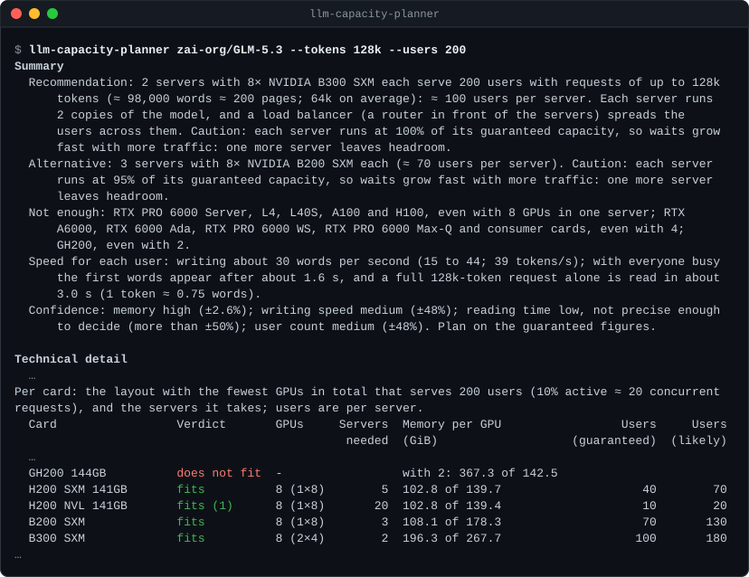
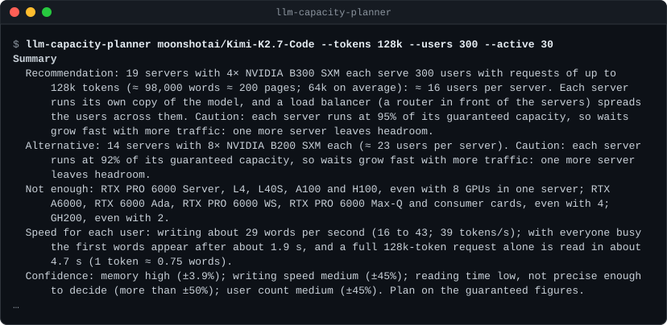
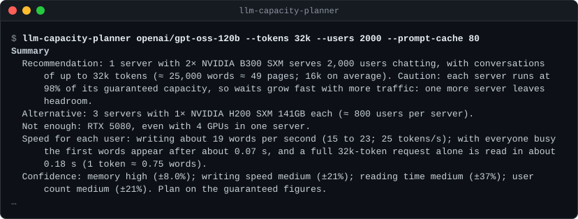
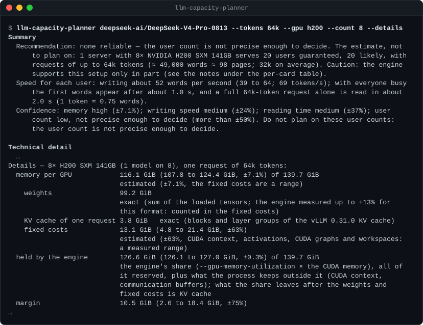
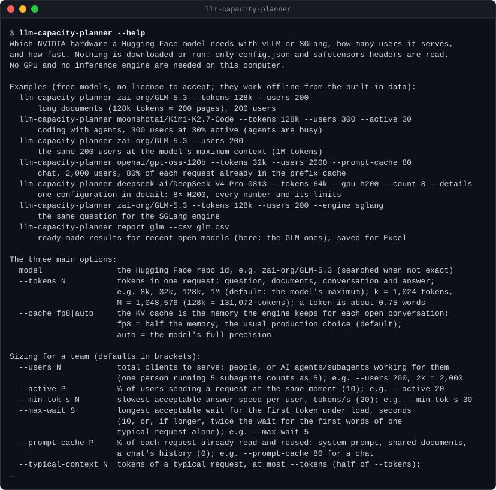

# LLM Capacity Planner — GPU memory and concurrency calculator for vLLM and SGLang

[](https://github.com/nemmusu/llm-capacity-planner/actions/workflows/ci.yml)
[](https://github.com/nemmusu/llm-capacity-planner/releases/latest)
[](LICENSE)
[](https://nodejs.org/)
[](#download)
[](#how-it-works)
[](#limits)

**A GPU sizing tool for LLM inference: for any Hugging Face model, it computes the VRAM the model needs on vLLM or SGLang (weights and KV cache), which NVIDIA GPUs fit it, from an RTX 3090 to H100, H200, B200 and B300 servers, how many concurrent users they serve and how many tokens per second each user gets.**

It is a VRAM and throughput calculator, not a benchmark. No GPU, no engine, nothing is run (unless you ask it to read this PC's card with `--this-pc`, which runs `nvidia-smi`): it computes from the model files and calibrated data. The model is never downloaded: only `config.json` and the safetensors headers (a few KB per shard, via HTTP Range requests) are read, and the models of the built-in catalog work offline.

<!-- generated:top -->


*Long documents (128k tokens), 200 users: the summary comes first, the technical detail after it.*

<details>
<summary>The same output as text</summary>

```text
$ llm-capacity-planner zai-org/GLM-5.3 --tokens 128k --users 200
Summary
  Recommendation: 2 servers with 8× NVIDIA B300 SXM each serve 200 users with requests of up to 128k
      tokens (≈ 98,000 words ≈ 200 pages; 64k on average): ≈ 100 users per server. Each server runs
      2 copies of the model, and a load balancer (a router in front of the servers) spreads the
      users across them. Caution: each server runs at 100% of its guaranteed capacity, so waits grow
      fast with more traffic: one more server leaves headroom.
  Alternative: 3 servers with 8× NVIDIA B200 SXM each (≈ 70 users per server). Caution: each server
      runs at 95% of its guaranteed capacity, so waits grow fast with more traffic: one more server
      leaves headroom.
  Not enough: RTX PRO 6000 Server, L4, L40S, A100 and H100, even with 8 GPUs in one server; RTX
      A6000, RTX 6000 Ada, RTX PRO 6000 WS, RTX PRO 6000 Max-Q and consumer cards, even with 4;
      GH200, even with 2.
  Speed for each user: writing about 30 words per second (15 to 44; 39 tokens/s); with everyone busy
      the first words appear after about 1.6 s, and a full 128k-token request alone is read in about
      3.0 s (1 token ≈ 0.75 words).
  Confidence: memory high (±2.6%); writing speed medium (±48%); reading time low, not precise enough
      to decide (more than ±50%); user count medium (±48%). Plan on the guaranteed figures.

Technical detail
  …
Per card: the layout with the fewest GPUs in total that serves 200 users (10% active ≈ 20 concurrent
requests), and the servers it takes; users are per server.
  Card                 Verdict       GPUs     Servers  Memory per GPU                 Users     Users
                                               needed  (GiB)                   (guaranteed)  (likely)
  …
  GH200 144GB          does not fit  -                 with 2: 367.3 of 142.5
  H200 SXM 141GB       fits          8 (1×8)        5  102.8 of 139.7                    40        70
  H200 NVL 141GB       fits (1)      8 (1×8)       20  102.8 of 139.4                    10        20
  B200 SXM             fits          8 (1×8)        3  108.1 of 178.3                    70       130
  B300 SXM             fits          8 (2×4)        2  196.3 of 267.7                   100       180
```

</details>
<!-- /generated:top -->

**Contents:** [Download](#download) · [Quick start](#quick-start) · [Features](#features) ·
[How accurate is it](#how-accurate-is-it) · [Examples](#examples) · [Options](#options) · [Limits](#limits) · [How it works](#how-it-works) ·
[Contributing](#contributing) · [License](#license)

## Download

Single executables with the built-in models inside: no Node.js, no GPU, nothing else to install. Get them from the
**[latest release](https://github.com/nemmusu/llm-capacity-planner/releases/latest)**; `SHA256SUMS.txt` there lists
their checksums.

| System | File | Example |
| --- | --- | --- |
| Windows (x64) | `llm-capacity-planner-windows-x64.exe` | `llm-capacity-planner-windows-x64.exe zai-org/GLM-5.3 --tokens 128k --users 200` |
| Linux (x64) | `llm-capacity-planner-linux-x64.tar.gz` | `tar -xzf llm-capacity-planner-linux-x64.tar.gz && ./llm-capacity-planner-linux-x64 zai-org/GLM-5.3 --tokens 128k --users 200` |
| macOS (Apple silicon) | `llm-capacity-planner-macos-arm64.tar.gz` | `tar -xzf llm-capacity-planner-macos-arm64.tar.gz && ./llm-capacity-planner-macos-arm64 zai-org/GLM-5.3 --tokens 128k --users 200` |
| macOS (Intel), when the release has it | `llm-capacity-planner-macos-x64.tar.gz` | as for Apple silicon |
| Any system with Node.js 22+ | `llm-capacity-planner.mjs` and `llm-capacity-planner-models.pack`, side by side | `node llm-capacity-planner.mjs zai-org/GLM-5.3 --tokens 128k --users 200` |

The executables are not signed. On macOS, Gatekeeper blocks a downloaded one the first time: allow it in System
Settings → Privacy & Security, or remove the quarantine flag with `xattr -d com.apple.quarantine llm-capacity-planner-macos-arm64`.

## Quick start

Give it a Hugging Face model; the options say what to answer (`llm-capacity-planner` stands for the file you
downloaded):

```bash
# The hardware for 200 users, with requests of up to 128k tokens each
llm-capacity-planner zai-org/GLM-5.3 --tokens 128k --users 200

# Users and speed of one configuration: 2 H100 GPUs, requests of up to 32k tokens
llm-capacity-planner openai/gpt-oss-120b --tokens 32k --gpu h100 --count 2

# The plans computed in advance for a built-in model
llm-capacity-planner report gpt-oss-120b
```

Any Hugging Face model works the same way; the 91 built-in ones also work offline. `--help` lists every option.

### Run from source (Node.js 22+)

```bash
npm ci
npm run plan -- zai-org/GLM-5.3 --tokens 128k --users 200
```

## Features

- **Exact memory.** Weights are summed tensor by tensor from the model's safetensors headers and split the way vLLM and SGLang load them; the KV cache follows the engines' own block and group rules. Nothing is downloaded but a few kilobytes of headers.
- **Calibrated speed with a declared error.** Generation speed, time to first token and concurrent users come from a roofline model fitted on measured runs and public benchmarks; every figure is a range, not a single guess.
- **No GPU, no engine, no download.** Reads a few KB of metadata per model (none for the built-in catalog). Runs on any laptop with Node.js 22+, or as a single executable on Windows, macOS and Linux.
- **Two levels of output.** A plain-language summary first (recommended hardware, number of servers, speed, confidence), then the technical detail. `--md` writes a one-page Markdown summary; `--csv` and `--json` export the full tables.

## How accurate is it

<!-- generated:accuracy -->
| What is estimated | How precise | Basis |
| --- | --- | --- |
| Memory: weights and KV cache | exact | the loaded tensors and the engine's own cache rules |
| Memory per GPU in total (fixed engine costs are a range) | ±3 % to ±8 % in the examples below | shown with every figure |
| Speed on vLLM: dense BF16, dense FP8, MoE MXFP4 | ±12 % generation, ±25 % prompt reading | fitted on 43 public benchmarks up to 8K tokens |
| Speed on SGLang: MoE BF16, MoE FP8, MoE NVFP4, MLA FP8 | ±30 % | fitted on 24 public benchmarks up to 4K tokens |
| Speed of any other model type or format | the range doubled (±24 % / ±50 % on vLLM) | labelled "estimated" |
| Contexts longer than the benchmarks | the range widened by half again | labelled next to the number |
| Layouts split in pipeline stages (no run measured them) | the range widened by half again (×1.5) | labelled "pipeline speed not measured" |
| A range of ±50 % or more | not precise enough to decide | labelled so |
<!-- /generated:accuracy -->

Calibrated on public benchmarks and on measured runs on a reference GPU, where the model types measured get their own, narrower ranges — see [Methodology §10](docs/METHODOLOGY.md#10-calibration). The table is generated from the code's calibration.

How each number is derived, and the measured error of every point: [docs/METHODOLOGY.md](docs/METHODOLOGY.md) and [its validation appendix](docs/appendix-c-validation.md).

**Tested:** 1,346 tests — unit, end-to-end on the real command, pairwise option combinations, invariants, golden outputs, accuracy regression, README images — with 100 % line and branch coverage (`npm run validate`), on Windows and on Linux (Node 22).

## Examples

Each example gives the command and its workload, the first line of the answer and an image of the summary; the technical detail follows it in the real output.

<!-- generated:examples -->
### The same documents, longer contexts

`llm-capacity-planner zai-org/GLM-5.3 --tokens <context> --users 200`: the longer each document, the fewer users one server serves; beyond 128k tokens the speed is extrapolated beyond the context verified; at 1M the model fits, but no server guarantees anyone a writing speed of 20 tokens/s for the answer (the low end of the estimate is below it; the likely users are in the table). Reading is a separate figure: the time to read a full context alone, in its own column.

| Context | One server | Users per server (guaranteed / likely) | Servers for 200 | Reading the full context alone | Writing speed estimate |
| --- | --- | --- | --- | --- | --- |
| 128k | 8× B300 SXM (2 copies × 4) | 100 / 180 | 2 | 3.0 s (1.1–4.9) | estimated, ±48 % |
| 268k | 8× B300 SXM (2 copies × 4) | 40 / 80 | 5 | 9.4 s (3.4–15.4) | estimated, ±49 % |
| 1M | 8× B300 SXM (1 model on 8): fits, nobody guaranteed 20 tok/s of writing | 0 / 10 | — | 47.9 s (18.3–77.5) | not precise enough to decide, ±57 % |

### Coding with agents, 300 users at 30% active

`llm-capacity-planner moonshotai/Kimi-K2.7-Code --tokens 128k --users 300 --active 30`: Each request carries up to 128k tokens of code and context, 64k on average, all of it read again: no prefix cache, the cautious case (agents that resend the same context gain from `--prompt-cache`). 30% of the users are active at the same moment, since agents keep working on their own.

19 servers with 4× NVIDIA B300 SXM each serve 300 users with requests of up to 128k tokens (≈ 98,000 words ≈ 200 pages; 64k on average): ≈ 16 users per server. Each server runs its own copy of the model, and a load balancer (a router in front of the servers) spreads the users across them. Caution: each server runs at 95% of its guaranteed capacity, so waits grow fast with more traffic: one more server leaves headroom.



### Chat, 2,000 users, 80% prefix cache

`llm-capacity-planner openai/gpt-oss-120b --tokens 32k --users 2000 --prompt-cache 80`: Conversations of up to 32k tokens; 80% of each one is already in the prefix cache (`--prompt-cache 80`), as in a chat that grows turn by turn. 10% of the users are active at the same moment.

1 server with 2× NVIDIA B300 SXM serves 2,000 users chatting, with conversations of up to 32k tokens (≈ 25,000 words ≈ 49 pages; 16k on average). Caution: each server runs at 98% of its guaranteed capacity, so waits grow fast with more traffic: one more server leaves headroom.



### One configuration in detail: 8× H200

`llm-capacity-planner deepseek-ai/DeepSeek-V4-Pro-0813 --tokens 64k --gpu h200 --count 8 --details`: A fixed configuration (`--gpu h200 --count 8`): documents of up to 64k tokens read without a prefix cache, and the memory item by item (`--details`).

none reliable — the user count is not precise enough to decide. The estimate, not to plan on: 1 server with 8× NVIDIA H200 SXM 141GB serves 20 users guaranteed, 20 likely, with requests of up to 64k tokens (≈ 49,000 words ≈ 98 pages; 32k on average). Caution: the engine supports this setup only in part (see the notes under the per-card table).


<!-- /generated:examples -->

## Options

| Option | Meaning | Default |
| --- | --- | --- |
| `<model> [tokens]` | Hugging Face repo, e.g. `zai-org/GLM-5.3 128k` | — |
| `--tokens N` | context of one request (prompt + history + answer), e.g. `32k` | model maximum |
| `--cache fp8\|auto` | KV cache precision | `fp8` |
| `--engine vllm\|sglang` | inference engine | `vllm` |
| `--users N` | total users to serve (`2k` = 2,000): recommends the hardware for them | — |
| `--active P` | % of users generating at the same moment | 10 % |
| `--gpu NAME`, `--count N` | the catalog cards whose name contains NAME (`h100` matches 3), and only 1, 2, 4, 8 or 16 GPUs of them | every card, 1 / 2 / 4 / 8 GPUs |
| `--all-hw` | every configuration, not only the best ones | — |
| `--min-tok-s N` | generation speed each user must keep | 20 tok/s |
| `--max-wait S` | longest wait for the first token under load | 10 s, or twice the first-token wait of one typical request alone (half the context, less what the prefix cache holds) when that is longer |
| `--prompt-cache P` | % of each prompt already in the prefix cache (chat: 80) | 0 |
| `--details` | memory item by item for the chosen configuration | — |
| `--md FILE` | a one-page Markdown summary (workload, recommended hardware, alternatives, confidence, assumptions) | — |
| `--csv FILE`, `--json FILE` | every table and number (`--csv-excel-eu` for `;` and decimal comma) | — |
| `--offline`, `--refresh` | use only local data / re-read the model from Hugging Face | — |
| `report [name]` | precomputed plans for recent open models | — |

**Users include AI agents.** Splitting work across parallel agents or subagents gets it done sooner, but each one is a concurrent client: 5 subagents count as 5 users. Agents are usually active all the time and send long contexts, so raise `--active` and `--tokens` for agent workloads.

`--help` lists every option. Gated models use `HF_TOKEN` or the token saved by `hf auth login`; it is never printed or stored.

<details>
<summary>The start of <code>--help</code></summary>



</details>

## Limits

- NVIDIA GPUs only: 24 card models from RTX 3090 to B300, each value with its NVIDIA source, or marked "derived" with how (the GB200 / GB300 NVL72 racks are in the data but not planned).
- Speed is calibrated on one reference GPU and on public benchmarks; other GPUs, model types and SGLang carry wider ranges, always shown.
- Expert parallelism, speculative decoding and a model split across servers are not modelled (independent servers, each with its own copy, are); Mistral-format checkpoints (params.json without config.json) are not read yet.
- Engine behaviour is pinned to vLLM 0.31.0 and SGLang 0.5.21; newer releases may need a recalibration ([how](docs/METHODOLOGY.md#14-updating-data-and-calibration)).

## How it works

1. **Model files.** It reads the model's `config.json` and the headers of its safetensors files from Hugging Face (or the
   built-in copy of them): tensor names, shapes and types, no weights.
2. **Memory per GPU.** The weights are summed tensor by tensor and split across GPUs the way vLLM and SGLang load them
   (tensor and pipeline parallelism); the KV cache follows each engine's block and group rules; the engine's fixed
   costs are a range.
3. **Will it start.** A compatibility matrix, checked against the engines' source code at the release tags it cites,
   says which model, format, GPU and parallel layout each engine runs.
4. **Speed and users.** A roofline model fitted on measured runs and public benchmarks gives the generation speed per
   user, the time to first token and the users each configuration serves, guaranteed and likely, each with its error.
5. **Servers.** Configurations follow NVIDIA's published GPUs per system and NVLink reach; more users than one server
   holds take more servers, each with its own copy of the model, behind a load balancer.

Documentation:

- [Methodology](docs/METHODOLOGY.md) — how every number is computed, validation and comparison with published methods
- [Data](data/README.md) — GPU catalog, model catalog, built-in models, public benchmarks and how to refresh them
- [Third-party data](NOTICE.md) — the sources and licences of the model metadata, benchmarks and GPU specifications
- [Changelog](CHANGELOG.md)

## Contributing

Bug reports, data updates (a model, a GPU, an engine release, a public benchmark) and pull requests are welcome:
[open an issue](https://github.com/nemmusu/llm-capacity-planner/issues/new/choose), and see
[CONTRIBUTING.md](CONTRIBUTING.md) for how to update the data, recalibrate and release. Security issues are reported
privately: [SECURITY.md](SECURITY.md).

`npm run build` writes a development bundle to `out/`; `npm run dist` builds what a release attaches into `dist/` (not
committed): the portable bundle, the models pack and the single executable of the current system. `--version` prints
the fingerprint of the sources a build comes from, and a test checks `dist/` against the sources when it is there.

## Disclaimer

The figures are estimates from a model of the engines, calibrated on measurements and public benchmarks, each with its
declared error; they are not guarantees, and real deployments can differ (drivers, kernels, settings, traffic). This
project is not affiliated with or endorsed by NVIDIA, the vLLM or SGLang projects, Hugging Face or the model providers;
their names and trademarks belong to their respective owners.

## License

[MIT](LICENSE) © 2026 nemmusu. Third-party data keeps its own terms: [NOTICE.md](NOTICE.md), with the full licence
texts in [licenses/](licenses/). To cite the project, see [CITATION.cff](CITATION.cff).
